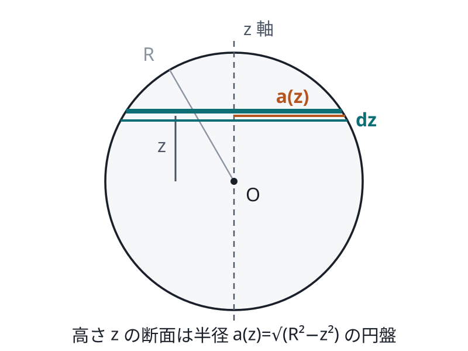
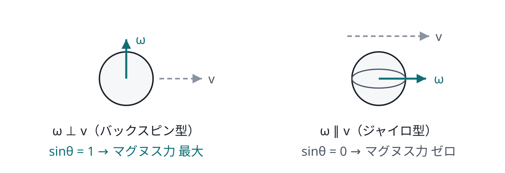
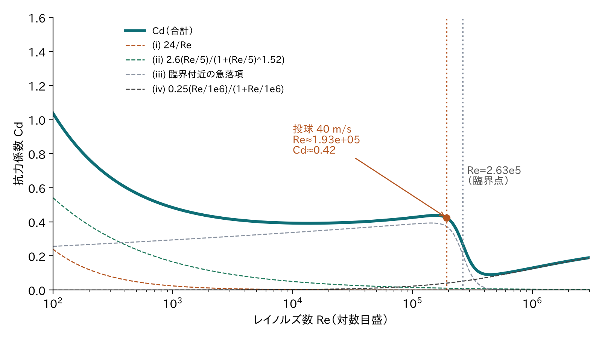
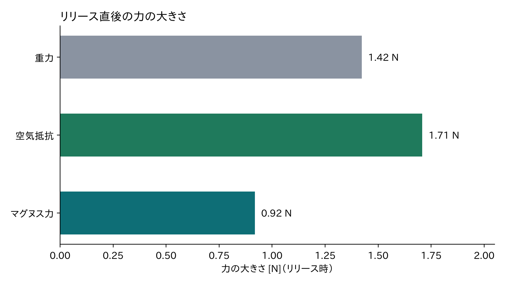
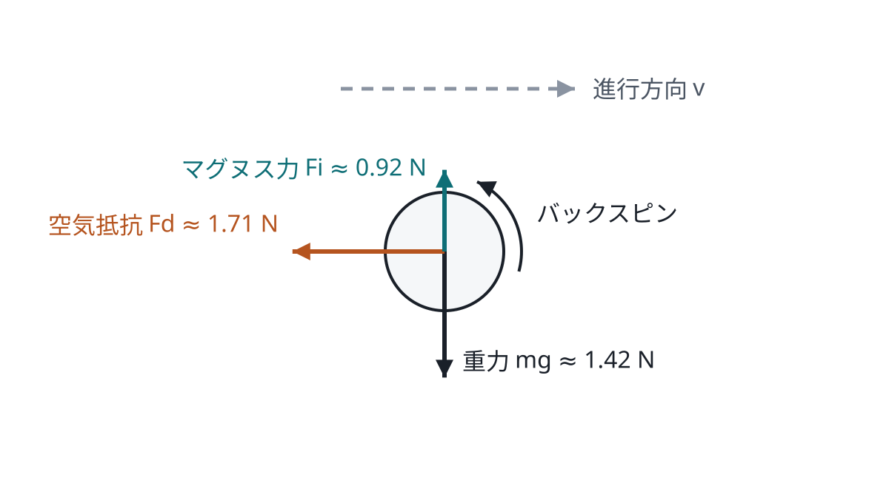
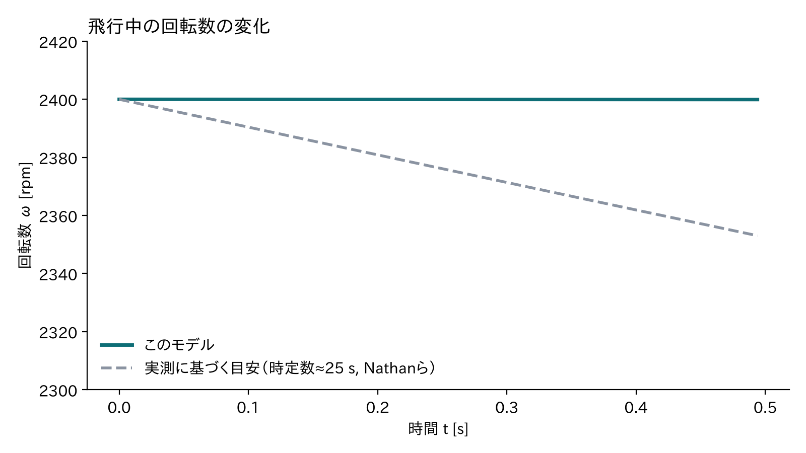
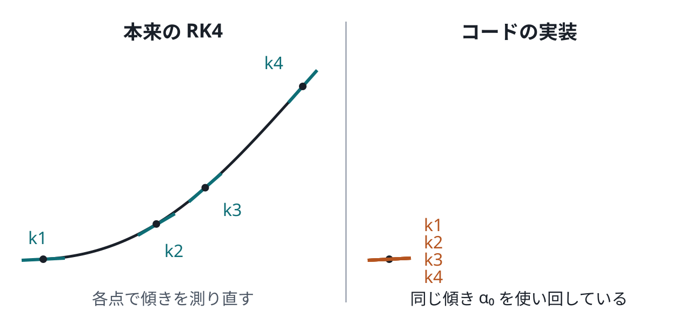
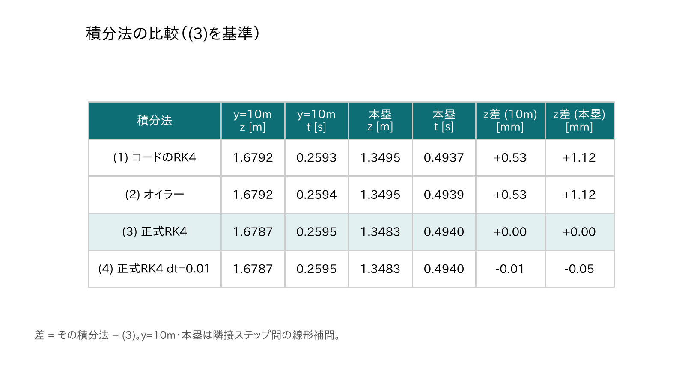
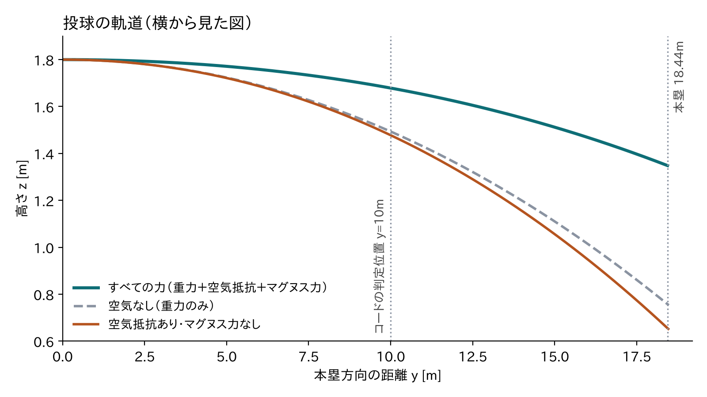

<!-- _class: lead -->
<!-- _paginate: false -->
<!-- _footer: "" -->

# 投球軌道シミュレーションの<br>数式を、高校生の武器で読む

**再考版** ― 数値を計算し直し、モデルとコードを検証しながら読み解く

<br>

前提：ベクトルと三角比（数学B・C）／指数とグラフ（数学II）／回帰直線（数学I）／運動方程式 $F=ma$（物理基礎）

---

## この資料で「再考」したこと

<div class="cols">
<div>

### 元の資料の数値を全部計算し直した

- $I,\ S,\ Re,\ C_d$（全項）, $F_d,\ C_i,\ F_i,\ C_m$, RK4の展開係数
- **すべて元の資料の値と一致**した

### 実際にシミュレーションを走らせた

- 「コードのRK4」「オイラー法」「本物のRK4」を比較
- 軌道・力・回転数をグラフにした

</div>
<div>

### 見つかった注意点（後半で詳しく）

| 区分 | 内容 |
|---|---|
| <span class="sev-e">誤り</span> | RK4の式で単位が合っていない |
| <span class="sev-e">誤り</span> | 回転が小さいとき揚力の式が破綻 |
| <span class="sev-e">誤り</span> | $C_d$ が $S$ に依存するという説明 |
| <span class="sev-w">要注意</span> | ホームベースが $y=10$ m |
| <span class="sev-w">要注意</span> | 回転がほぼ減らない |
| <span class="sev-w">要注意</span> | 滑らかな球の $C_d$ を使用 |

<div class="small">

「再考」マークのスライドで、それぞれを説明します。

</div>
</div>
</div>

---

## 全体の地図

<div class="cols-l">
<div>

ボールの状態は<strong>3つの矢印（ベクトル）</strong>で表す

- 位置 $\mathbf s$
- 速度 $\mathbf v$（大きさ $v$）
- 角速度 $\boldsymbol\omega$（回転の速さと軸、大きさ $\omega$）

例として使うのは、**球速 40 m/s・2400 rpm（$\omega\approx251$ rad/s）のバックスピン**のストレート

</div>
<div>

| 節 | 内容 |
|---|---|
| 1 | 記号と値、慣性モーメント |
| 2 | スピンパラメータ $S$ |
| 3 | $Re$ と抗力係数 $C_d$ |
| 4 | 空気抵抗力 |
| 5 | マグヌス力 |
| 6 | 回転の減衰 |
| 7 | 運動方程式 |
| 8 | 数値積分（RK4） |
| 9 | ストライク判定 |

</div>
</div>

---

<!-- _class: section -->

# 1　準備：ボールと空気の性質

---

<span class="tag">1</span>

## 記号と値

| 記号 | 意味 | 値 |
|---|---|---|
| $m$ | ボールの質量 | 0.145 kg |
| $r$ | ボールの半径（直径 $d=2r$） | 0.0365 m |
| $A=\pi r^2$ | 正面から見た円の面積 | 0.00419 m² |
| $I=\tfrac25 mr^2$ | 回転のしにくさ（慣性モーメント） | $7.73\times10^{-5}$ kg·m² |
| $\rho$ | 空気の密度 | 1.205 kg/m³ |
| $\mu$ | 空気の粘性係数（ねばり気） | $1.822\times10^{-5}$ Pa·s |

<div class="small">

$A$ はボールが空気を正面から押し分ける面積。$\mu$ ははちみつなら大きく、空気は小さいがゼロではない。

</div>

---

<span class="tag">1</span>

## 係数「2/5」はどこから？ ① 薄い円盤

<div class="cols-r">
<div>

慣性モーメントの定義

$$I=\int s^2\,dm$$

（$s$：回転軸からの距離）

使う積分は数学IIの
$\displaystyle\int z^n dz = \frac{z^{n+1}}{n+1}$ だけ

</div>
<div>

半径 $a$ の円盤を、幅 $ds$ の細いリングに分ける。面密度 $\sigma=\dfrac{m_{\text{disk}}}{\pi a^2}$ とすると $dm=\sigma\cdot 2\pi s\,ds$

$$I_{\text{disk}}=\int_0^a s^2\,\sigma\,2\pi s\,ds = \frac{\pi\sigma a^4}{2}$$

$\sigma$ を代入すると

$$I_{\text{disk}}=\frac12\,m_{\text{disk}}\,a^2$$

</div>
</div>

---

<span class="tag">1</span>

## ② 球を円盤の積み重ねと見る

<div class="cols">
<div>



</div>
<div>

高さ $z$ の断面の半径は、球の式 $x^2+y^2+z^2=R^2$ より

$$a(z)=\sqrt{R^2-z^2}$$

その円盤の質量と慣性モーメントは

$$dm=\rho_{\text{球}}\,\pi a(z)^2\,dz$$

$$dI=\tfrac12\,dm\cdot a(z)^2=\tfrac12\rho_{\text{球}}\pi\,a(z)^4\,dz$$

</div>
</div>

---

<span class="tag">1</span>

## ③ 積分して 2/5 を出す

$a(z)^4=(R^2-z^2)^2=R^4-2R^2z^2+z^4$。偶関数なので $\int_{-R}^{R}=2\int_0^R$ にできる。

$$\int_0^R\!\left(R^4-2R^2z^2+z^4\right)dz = R^5\left(1-\tfrac23+\tfrac15\right)=\tfrac{8}{15}R^5$$

$$I=\frac{\pi\rho_{\text{球}}}{2}\cdot\frac{16}{15}R^5,\qquad \rho_{\text{球}}=\frac{3M}{4\pi R^3}\ \text{を代入}\ \Rightarrow\ I=\frac25 MR^2$$

<div class="box good">

**数字で確認：** $0.4\times0.145\times0.0365^2\approx7.73\times10^{-5}$ kg·m²（表の値と一致）

</div>

<div class="box warn">

<span class="tag re">再考</span> これは**密度が一様な球**の値。本物の野球ボールは中心にコルクやゴムの芯があり、厳密には少し違う。

</div>

---

<!-- _class: section -->

# 2　無次元スピンパラメータ $S$

「回転がどれだけ効いているか」を表す1つの数

---

<span class="tag">2</span>

## 外積を、知っている公式から橋渡し

<div class="cols">
<div>

**数学C：** 平行四辺形の面積

$$S_{\text{面積}}=|a_1b_2-a_2b_1|=|\mathbf a||\mathbf b|\sin\theta$$

**3次元の外積** $\mathbf a\times\mathbf b$

- 大きさ：$|\mathbf a\times\mathbf b|=|\mathbf a||\mathbf b|\sin\theta$（同じ形）
- 向き：$\mathbf a,\mathbf b$ の両方に垂直（右手の法則）

</div>
<div>



<div class="small center">

回転軸の向き $\theta$ で、効き方が変わる

</div>
</div>
</div>

---

<span class="tag">2</span>

## スピンパラメータ $S$

$$S=\frac{r\,|\boldsymbol\omega\times\mathbf v|}{|\mathbf v|^2}=\frac{r\,\omega\,v\sin\theta}{v^2}=\frac{r\,\omega\sin\theta}{v}$$

- 分子 $r\omega\sin\theta$：表面が回転で動く速さ（進行方向に**垂直な**成分だけ）
- 分母 $v$：ボールが前に進む速さ
- バックスピン（$\theta=90^\circ$）で最大、ジャイロ回転（$\theta=0^\circ$）で $S=0$

<div class="box good">

**数字で確認：** $S=\dfrac{0.0365\times251}{40}\approx 0.229$

</div>

<div class="box warn">

<span class="tag re">再考</span> 元の資料には「抗力係数も揚力係数も $S$ だけに依存する」とあるが、このモデルで $S$ に依存するのは **$C_i$ と $C_m$ だけ**。$C_d$ は $Re$ だけで決まる。

</div>

---

<!-- _class: section -->

# 3　レイノルズ数と抗力係数 $C_d$

---

<span class="tag">3</span>

## レイノルズ数 $Re$

$$Re=\frac{\rho\,v\,d}{\mu}$$

- 「流れの勢い（$\rho v d$：密度・速さ・大きさ）」と「粘り気 $\mu$」の比
- $Re$ が大きいほど勢いが勝ち、流れは**乱れやすい（乱流）**
- 単位が打ち消し合い、**単位のない数**（無次元数）になる

<div class="box good">

**数字で確認：** $Re=\dfrac{1.205\times40\times0.073}{1.822\times10^{-5}}\approx1.93\times10^5$

</div>

---

<span class="tag">3</span>

## Morrison（2013）の経験式

<div class="eqs">

$$
C_d=\underbrace{\frac{24}{Re}}_{(\text i)}
+\underbrace{\frac{2.6\left(\frac{Re}{5}\right)}{1+\left(\frac{Re}{5}\right)^{1.52}}}_{(\text{ii})}
+\underbrace{\frac{0.411\left(\frac{Re}{2.63\times10^{5}}\right)^{-7.94}}{1+\left(\frac{Re}{2.63\times10^{5}}\right)^{-8.00}}}_{(\text{iii})}
+\underbrace{\frac{0.25\left(\frac{Re}{10^{6}}\right)}{1+\frac{Re}{10^{6}}}}_{(\text{iv})}
$$

</div>

<div class="box">

**経験式とは：** 数学Iの回帰直線と同じ発想。実験データに**式の形を当てはめた**もので、各項に理論的な根拠はない。「全体として実測に合う」ことだけが基準。

</div>

<div class="box warn">

<span class="tag re">再考</span> 第4項は、原典では $Re^{0.8}/461000$ の形と記憶している（確実ではない）。コードの式と原典を照らし合わせることを推奨。違いが効くのは $Re$ がとても大きいときだけ。

</div>

---

<span class="tag">3</span>

## $C_d$–$Re$ カーブ（式から計算して描いた）

<div class="cols-l">
<div>



</div>
<div>

| $Re$ | 合計 $C_d$ |
|---|---|
| $10^2$ | 1.038 |
| $10^3$ | 0.484 |
| $10^5$ | 0.426 |
| **$1.93\times10^5$（投球）** | **0.423** |
| $2.63\times10^5$ | 0.267 |
| $4\times10^5$ | 0.093 |
| $3\times10^6$ | 0.190 |

<div class="small">

(iii) が広い範囲で主役。$2.6\times10^5$ 付近で急落する（ドラッグ・クライシス）

</div>
</div>
</div>

---

<span class="tag">3</span>

## ドラッグ・クライシスと、その注意点

<div class="box">

**なぜ急落する？** 流れが乱流になると、ボールの後ろで流れが**剥がれにくく**なり、後ろの渦が小さくなる → 抵抗が一気に下がる（ゴルフボールのディンプルはこれを利用）

</div>

<div class="box warn">

<span class="tag re">再考 ①</span> $Re=2.63\times10^5$ は「急落の開始点」ではなく、すでに $C_d$ が 0.44 → 0.27 に下がった後。**急落は $Re\approx1.5\sim2\times10^5$ で始まり、40 m/s の投球はその入り口にいる。** 球速が 40→50 m/s になるだけで $C_d$ は 0.42→0.33 に変わる。

</div>

<div class="box warn">

<span class="tag re">再考 ②</span> この式は**滑らかな球**のもの。縫い目のある野球ボールの実測では、投球の速さで $C_d\approx0.3\sim0.4$ 程度で、鋭い急落は見られないとされる。回転による $C_d$ の変化も入っていない。

</div>

---

<!-- _class: section -->

# 4　空気抵抗力

---

<span class="tag">4</span>

## 抵抗係数の定義から力の式へ

<div class="cols">
<div>

$C_d$ はもともとこう**定義**される量

$$C_d\equiv\frac{F_d}{\tfrac12\rho A v^2}$$

$F_d$ について解くだけ

$$F_d=\tfrac12\,C_d\,\rho\,A\,v^2$$

向きは進行方向と**反対**

</div>
<div>



<div class="small center">

$F_d\approx1.71$ N は重力 $mg\approx1.42$ N より**大きい**

</div>
</div>
</div>

<div class="small">

<span class="tag re">再考</span> 「速さ2倍で抵抗4倍」は $C_d$ が一定のときの話。この速さ付近では $C_d$ 自体が速さで変わる。

</div>

---

<!-- _class: section -->

# 5　マグヌス力（揚力）

変化球の「曲がり」の正体

---

<span class="tag">5</span>

## 揚力係数と力の大きさ

$$C_i(S)=0.09+0.6\,S$$

- 実測データに**直線を当てはめた**もの（Sawicki ら 2003、Nathan 2008）
- 例：$S=0.229$ のとき $C_i\approx0.228$

$$\mathbf F_i=\tfrac12\,C_i\,\rho\,A\,v^2\;\frac{\mathbf v\times\boldsymbol\omega}{|\mathbf v\times\boldsymbol\omega|}$$

<div class="box good">

**数字で確認：** $F_i\approx0.92$ N。重力の約 0.65 倍で、ボールは浮かないが軌道は大きく変わる

</div>

---

<span class="tag">5</span>

## 力の向き：垂直な回転成分だけが効く

<div class="cols">
<div>

$\boldsymbol\omega=\boldsymbol\omega_\parallel+\boldsymbol\omega_\perp$ に分けると

$$\mathbf v\times\boldsymbol\omega=\mathbf v\times\boldsymbol\omega_\perp$$

平行成分は $\sin0=0$ で消える

**向きの確認（座標で計算）**
$x$：右、$y$：本塁方向、$z$：上
$\mathbf v=(0,40,0)$、バックスピン $\boldsymbol\omega=(+251,0,0)$
$\boldsymbol\omega\times\mathbf v=(0,0,+251\times40)$ → **上向き**

</div>
<div>



<div class="small">

運動方程式では $-\mathbf F_i$ として入るので、実際に効く向きは $\boldsymbol\omega\times\mathbf v$ 方向。教えるときは「$\boldsymbol\omega\times\mathbf v$ 向きの力を**足す**」と書く方がわかりやすい。

</div>
</div>
</div>

---

<span class="tag re">再考</span>

## 回転が小さいとき、揚力の式が破綻する

<div class="box err">

**問題 1：** $S=0$（回転なし）でも $C_i=0.09$ となり、**回転していないのに揚力が出る**

**問題 2：** 回転なし、または純粋なジャイロ回転のとき $\mathbf v\times\boldsymbol\omega=\mathbf 0$ となり、向きの式 $\dfrac{\mathbf v\times\boldsymbol\omega}{|\mathbf v\times\boldsymbol\omega|}$ が **$0\div0$** になる

</div>

<div class="box">

**修正案：** Sawicki ら（2003）は、次のように $S$ で場合分けしているとされる（約85%の確度の記憶。**原典で要確認**）

$$C_L=\begin{cases}1.5\,S & (S\le0.1)\\ 0.09+0.6\,S & (S>0.1)\end{cases}\qquad(S=0.1\ \text{で}\ 0.15\ \text{に連続につながる})$$

こうすれば $S\to0$ で揚力も 0 になり、$0\div0$ も避けられる。今回の例（$S=0.229$）は有効範囲内なので、数値は正しい。

</div>

---

<!-- _class: section -->

# 6　スピン減衰トルク

---

<span class="tag">6</span>

## 回転の運動方程式

$$C_m(S)=2\times10^{-5}\,S,\qquad \tau=\tfrac12\,C_m\,\rho\,A\,v^2\,d$$

$F=ma$ の回転版 $I\dot\omega=\tau$（$F\to\tau$、$m\to I$、$a\to\dot\omega$）を、回転を弱める向きに使う

$$\dot{\boldsymbol\omega}=-\frac{\tfrac12 C_m\rho A v^2 d}{I}\,\hat{\boldsymbol\omega}$$

<div class="box good">

**数字で確認：** $C_m\approx4.6\times10^{-6}$、$\dot\omega\approx0.017$ rad/s²。本塁まで（約 0.49 秒）で回転数は **2400 → 2399.9 rpm（0.003%減）**

</div>

---

<span class="tag re">再考</span>

## 回転はほとんど減らない ― 実測と比べると？

<div class="cols-l">
<div>



</div>
<div>

- 実際の投球データからの推定では、回転は**時定数が数秒〜数十秒**で減るとされる
- 本塁までに **約 1〜9% 減**
- このモデルの減り方は、それより **2〜3桁小さい**

<div class="small">

点線は時定数 25 秒とした目安（文献値の概算）。$C_m=2\times10^{-5}S$ が Alaways（1998）の値かどうかも、原典で確認が必要。

</div>
</div>
</div>

<div class="box warn">

軌道への影響は小さいが、「実際の投球でも回転数はほとんど変わらない」とまでは言えない

</div>

---

<!-- _class: section -->

# 7　運動方程式にまとめる

---

<span class="tag">7</span>

## $F=ma$ に3つの力を代入する

<div class="cols">
<div>

$$
\begin{aligned}
\dot{\boldsymbol\omega}&=\boldsymbol\alpha(\boldsymbol\omega,\mathbf v)\\[4pt]
\dot{\mathbf v}&=\frac{\mathbf F_g-\mathbf F_d-\mathbf F_i}{m}\\[4pt]
\dot{\mathbf s}&=\mathbf v
\end{aligned}
$$

- $\dot{\mathbf v}$ は「$\mathbf v$ の変化の割合」＝加速度
- $\mathbf F_g=m(0,0,-9.81)$

</div>
<div>


</div>
</div>

<div class="box">

重力以外の力は、すべて**今の速度や回転で変わる**。だから手計算で一気に解けず、短い時間 $\Delta t$ ごとに少しずつ進める → **数値積分**

</div>

---

<!-- _class: section -->

# 8　数値積分：RK4を展開してみる

---

<span class="tag">8</span>

## 本来の RK4

<div class="cols">
<div>

$$
\begin{aligned}
k_1&=f(y_n)\\
k_2&=f(y_n+\tfrac12k_1\Delta t)\\
k_3&=f(y_n+\tfrac12k_2\Delta t)\\
k_4&=f(y_n+k_3\Delta t)\\
y_{n+1}&=y_n+\tfrac{\Delta t}{6}(k_1+2k_2+2k_3+k_4)
\end{aligned}
$$

</div>
<div>



</div>
</div>

<div class="box">

ポイント：$k_2,k_3,k_4$ は**途中の状態で $f$（傾き）を測り直した値**。これで $\Delta t$ の間の力の変化を取り込み、精度を上げる。

</div>

---

<span class="tag">8</span>

## コードでは何をしているか

```matlab
alpha0 = alpha(w(i-1,:), v(i-1,:));  % 1度だけ計算
k1 = alpha0*dt;
k2 = (alpha0 + k1/2)*dt;
k3 = (alpha0 + k2/2)*dt;
k4 = (alpha0 + k3  )*dt;
w(i,:) = w(i-1,:) + (k1+2*k2+2*k3+k4)/6;
```

$k_2,k_3,k_4$ に $\alpha_0$ しか出てこない。代入と展開を繰り返すと

$$
\begin{aligned}
k_2&=\alpha_0\Delta t+\tfrac12\alpha_0\Delta t^2,\qquad
k_3=\alpha_0\Delta t+\tfrac12\alpha_0\Delta t^2+\tfrac14\alpha_0\Delta t^3\\
k_4&=\alpha_0\Delta t+\alpha_0\Delta t^2+\tfrac12\alpha_0\Delta t^3+\tfrac14\alpha_0\Delta t^4
\end{aligned}
$$

---

<span class="tag">8</span>

## 平均すると、ほぼオイラー法

$$\Delta w=\frac{k_1+2k_2+2k_3+k_4}{6}=\alpha_0\Delta t\left(1+\tfrac12\Delta t+\tfrac16\Delta t^2+\tfrac1{24}\Delta t^3\right)$$

<div class="box good">

**数字で確認：** $\Delta t=0.001$ ならカッコの中は $\approx1.0005$。つまり $\Delta w\approx\alpha_0\Delta t$ ＝ **オイラー法**（次の値＝今の値＋変化の割合×時間の刻み）

</div>

位置の更新も同じ構造で、区間の最初の $\mathbf v_{i-1}$ を定数として使っている
→ $\Delta\mathbf s\approx\mathbf v_{i-1}\Delta t$（等速直線運動の式）

---

<span class="tag re">再考</span>

## さらに深刻：単位が合っていない

<div class="box err">

`k2 = (alpha0 + k1/2)*dt` は、**角加速度** $\alpha_0$（rad/s²）と**角速度の変化** $k_1$（rad/s）を足している。単位の違う量を足すのは、物理の式としては**誤り**。

</div>

その結果、カッコ $\left(1+\tfrac12\Delta t+\cdots\right)$ の値は**時間の単位の選び方で変わってしまう**

| 時間の単位 | $\Delta t$ の数値 | カッコの値 |
|---|---|---|
| 秒 | 0.001 | 1.0005 |
| ミリ秒 | 1 | **1.708** |

<div class="small">

ミリ秒で書いていたら、軌道は6 m以上ずれる。秒で書いているので結果はたまたま小さい誤差で済んでいる。「1.0005 は補正」ではなく「**単位に依存する小さなずれ**」と読むのが正しい。

</div>

---

<span class="tag re">再考</span>

## シミュレーションで比べてみた



<div class="small center">

コードの「RK4」≒ オイラー法。本物の RK4 との差は本塁で約 1 mm（$\Delta t=0.01$ s でも 0.05 mm）

</div>

---

<span class="tag">8</span>

## 正しい RK4 の書き方（例）

```matlab
% 状態 X = [s; v; w] をまとめて扱う
f  = @(X) [ X(4:6);              % ds/dt = v
            accel(X(4:6), X(7:9));   % dv/dt = (Fg - Fd - Fi)/m
            alpha(X(7:9), X(4:6)) ]; % dw/dt
k1 = f(X);
k2 = f(X + dt/2*k1);     % 途中の状態で測り直す
k3 = f(X + dt/2*k2);
k4 = f(X + dt  *k3);
X  = X + dt/6*(k1 + 2*k2 + 2*k3 + k4);
```

<div class="box">

**結論：** 今回は $\Delta t$ が小さいので実用上の影響はわずか（約 1 mm）。ただし「RK4 だから高精度」とは言えない。「オイラー法」と正直に書くか、上のように本物の RK4 にするのがよい。

</div>

---

<!-- _class: section -->

# 9　着地点とストライクゾーン

---

<span class="tag">9</span>

## 判定の式

$$\text{point}=\min\{\,i : s_y(i)>10\,\},\qquad \mathbf s_{\text{plate}}=\mathbf s(\text{point})$$

- $y$（投げる方向）が初めて 10 m を超えたステップの位置を取り出す
- $x\in\{-0.2,\,0,\,0.2\}$ m、$z\in\{0.5,\,0.8,\,1.1\}$ m の 3×3 ストライクゾーンと重ねて表示

<div class="box warn">

<span class="tag re">再考</span> **補間をしていない**ので、取り出す位置は 10 m を最大で約 3.7 cm 越えている。これは数値積分の誤差（約 1 mm）より大きい。2つのステップの間を直線で補間するとよい。

</div>

---

<span class="tag re">再考</span>

## 本塁が $y=10$ m なのは近すぎる

<div class="cols-l">
<div>



</div>
<div>

- プレートから本塁までは **18.44 m**。踏み出しを考えると、実際に飛ぶのは **約 16.5〜17 m**
- 10 m までは **0.26 秒**（「0.5 秒ほど」と合わない）
- マグヌス力の浮き上がり：10 m で約 20 cm、16.8 m で約 57 cm → 変化量を**約 3 分の 1 に過小評価**

</div>
</div>

---

<!-- _class: section -->

# まとめ

---

## 再考のまとめ

| 区分 | 箇所 | 内容 | 直し方 |
|---|---|---|---|
| <span class="sev-e">誤り</span> | 8 RK4 | 単位の違う量を足している | 本物の RK4 にする |
| <span class="sev-e">誤り</span> | 5 揚力 | $S\to0$ で揚力が残る・$0\div0$ | $S\le0.1$ で $1.5S$ |
| <span class="sev-e">誤り</span> | 2 の説明 | $C_d$ は $S$ に依存しない | 説明を修正 |
| <span class="sev-w">要注意</span> | 9 判定 | 本塁 10 m・補間なし | 約 16.8 m・補間 |
| <span class="sev-w">要注意</span> | 6 減衰 | 減衰が実測より 2〜3 桁小さい | 実測ベースの値 |
| <span class="sev-w">要注意</span> | 3 $C_d$ | 滑らかな球・急落位置の説明 | 野球ボールの実測値 |
| <span class="sev-n">補足</span> | 1 $I$ | 一様な球の仮定 | 注記を入れる |
| <span class="sev-n">補足</span> | 5 向き | 符号は正しい | $\boldsymbol\omega\times\mathbf v$ で説明 |

<div class="small center">

数値計算そのもの（$I, S, Re, C_d, F_d, F_i, C_m$、展開係数）はすべて正しかった

</div>

---

## 高校数学・物理とのつながり

| 出てきた式 | 使った考え方 |
|---|---|
| $A=\pi r^2$、$I=\tfrac25mr^2$ | 円の面積、多項式の積分（数学II）、偶関数 |
| $S=r\omega\sin\theta/v$ | ベクトル・外積・三角比（数学C） |
| $Re$、$C_d$ の経験式 | 比、指数関数、回帰直線（数学I・II） |
| $F_d,\ F_i$ | 定義式を解く、力の合成（物理基礎） |
| $I\dot\omega=\tau$ | $F=ma$ の回転版 |
| RK4・オイラー法 | 代入と展開、「変化の割合×時間」 |
| 単位のチェック | **次元解析**：違う単位の量は足せない |

---

## 参考文献

- Morrison, F. A. (2013). *An Introduction to Fluid Mechanics*. Cambridge University Press.（球の $C_d$ の経験式）
- Sawicki, G. S., Hubbard, M., & Stronge, W. J. (2003). How to hit home runs. *American Journal of Physics*, 71(11).（揚力係数）
- Nathan, A. M. (2008). The effect of spin on the flight of a baseball. *American Journal of Physics*, 76(2).（揚力係数・回転の減衰）
- Alaways, L. W. (1998). *Aerodynamics of the Curve-ball*. PhD thesis, UC Davis.（回転の減衰）

<div class="small">

※「原典で要確認」と書いた点（Sawicki らの場合分け、Morrison の第4項、回転減衰の時定数、$C_m$ の出典）は、記憶に基づく指摘を含みます。正式な資料にする前に原典を確認してください。

</div>

---

<!-- _class: lead -->
<!-- _paginate: false -->
<!-- _footer: "" -->

# おつかれさまでした

式を「読む」とは、**数字を入れて確かめ**、**単位をそろえて疑い**、**実測と比べる**こと

<div class="small" style="color:#D4ECEE">

シミュレーションのコード：`slides/pitch/sim/`　再検証レポート：`slides/pitch/review.md`

</div>
