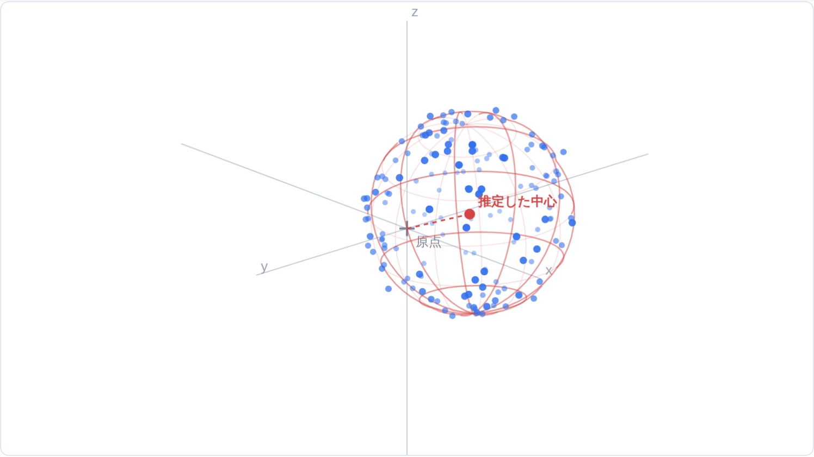
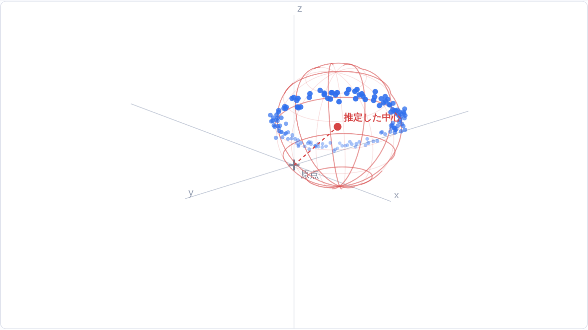
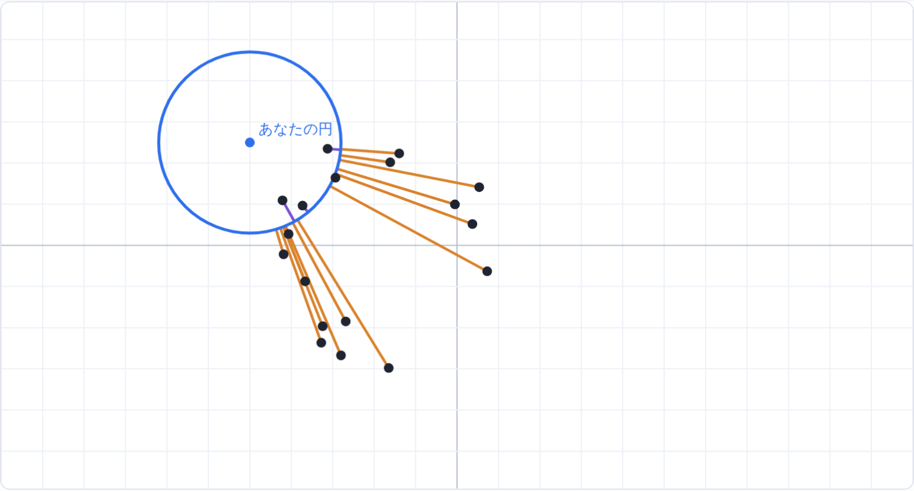
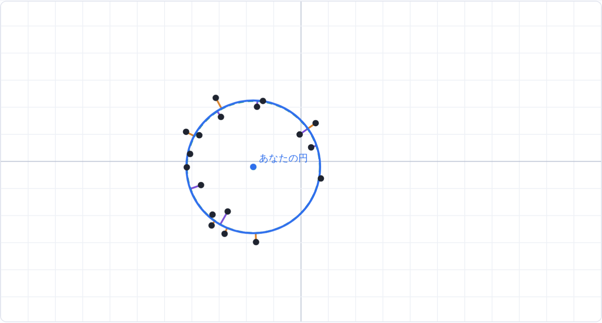
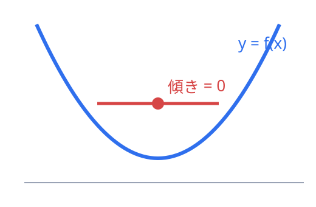

<!-- _class: lead -->
<!-- _paginate: false -->
<!-- _footer: "" -->

# 最小二乗法で「球」を当てはめよう

ばらばらの点から「いちばんよく合う球」の中心と半径を求める

<br>

前提：2次関数・微分／円の方程式／連立方程式
新しく学ぶ：偏微分・行列

<div class="small" style="color:#cfe0ff">

元記事：「最小二乗法による球の推定」（yujikaneko さん / Qiita）<br>https://qiita.com/yujikaneko/items/955b4474772802b055bc

</div>

---

## この授業のゴール

- 「最小二乗法」が**何を最小にしているのか**説明できる
- 球の当てはめが**連立1次方程式**に帰着する理由がわかる
- **掃き出し法**で逆行列を求める手順をたどれる
- スマホのコンパス補正にこの計算が使われる理由がわかる

<div class="flow">
<div><span>STEP 3</span>ズレを式に</div>
<div><span>STEP 3</span>2乗して合計</div>
<div><span>STEP 4</span>置き換え</div>
<div><span>STEP 5</span>微分＝0</div>
<div><span>STEP 6・7</span>行列で解く</div>
<div><span>STEP 6</span>中心・半径へ</div>
</div>

---

<!-- _class: section -->

# STEP 1　何がしたいの？

スマホのコンパスの話

---

<span class="step">STEP 1</span>

## スマホの磁気センサ

<div class="cols-60">
<div>

- スマホの**磁気センサ**は、地磁気を $(x,\,y,\,z)$ の3つの数値で測る
- 地磁気の強さはほぼ一定 → いろいろな向きで測ると、点は**球面の上**に並ぶ
- 理想の中心は原点 $(0,0,0)$
- でも内部の部品の磁気で、**中心が原点からずれる**（オフセット）

<div class="box">
<div>

<strong>やりたいこと：</strong>点の集まりから<b>球の中心（＝オフセット）と半径</b>を求める

</div>
</div>

</div>
<div>


<div class="small center">

青：測定点　赤：推定した球と中心

</div>

</div>
</div>

---

<span class="step">STEP 1</span>

## 「8の字に回して」の正体

<div class="cols">
<div>


<div class="center">

いろいろな向きに回す<br><b>中心の誤差 0.67 µT</b>（よく当たる）

</div>

</div>
<div>



<div class="center">

机の上で水平に回すだけ<br><b>中心の誤差 19.5 µT</b>（大きくずれる）

</div>

</div>
</div>

<div class="small center">

本当の中心 (25, −15, 10) µT、半径 46 µT、ノイズ 2 µT、150点でのシミュレーション。理由は STEP 9 で考えます。

</div>

---

<!-- _class: section -->

# STEP 2　球の方程式

---

<span class="step">STEP 2</span>

## 円の方程式 → 球の方程式

数学IIの**円の方程式**（中心 $(a,b)$、半径 $r$）

$$(x-a)^2 + (y-b)^2 = r^2$$

3次元にすると、中心 $(x_0,\,y_0,\,z_0)$、半径 $r$ の**球面**

$$(x-x_0)^2 + (y-y_0)^2 + (z-z_0)^2 = r^2$$

求めたい未知数は $x_0,\ y_0,\ z_0,\ r$ の **4つ**

<div class="box hs">
<div>

<b>考えてみよう：</b>中心 $(1,\,-2,\,3)$、半径 $2$ の球は？<br>
→ $(x-1)^2 + (y+2)^2 + (z-3)^2 = 4$

</div>
</div>

---

<!-- _class: section -->

# STEP 3　「ズレ」を数で表す

最小二乗法の考え方

---

<span class="step">STEP 3</span>

## 点ごとのズレ $e_k$

測定点 $(x_k, y_k, z_k)$（$k=1,\dots,n$）を球の式に入れて $r^2$ を引く

$$e_k = (x_k-x_0)^2 + (y_k-y_0)^2 + (z_k-z_0)^2 - r^2$$

| 点の位置 | $e_k$ の値 |
|---|---|
| ちょうど球面の上 | $0$ |
| 球の外側 | プラス |
| 球の内側 | マイナス |

ただ足すと、プラスとマイナスが**打ち消し合って**しまう…

---

<span class="step">STEP 3</span>

## 2乗して合計 ＝ 最小二乗法

$$J = \sum_{k=1}^{n} e_k^{\,2} = \sum_{k=1}^{n} \Bigl\{(x_k-x_0)^2 + (y_k-y_0)^2 + (z_k-z_0)^2 - r^2\Bigr\}^2$$

<div class="box">
<div>

この $J$（<b>目的関数</b>）がいちばん小さくなる $x_0,\,y_0,\,z_0,\,r$ を<br>「いちばんよく合う球」とする → <strong>最小二乗法</strong>

</div>
</div>

<div class="box hs">
<div>

<b>Σ記号の復習（数学B）：</b>$\displaystyle\sum_{k=1}^{n} a_k = a_1 + a_2 + \cdots + a_n$<br>以下では範囲を省略して $\Sigma a_k$ と書く

</div>
</div>

---

<span class="step">STEP 3</span>

## 体験：手で $J$ を小さくしてみると…（2次元＝円）

<div class="cols">
<div>



<div class="center">

適当な円：$J = 6837.6$<br><span class="small">オレンジ＝外側のズレ　紫＝内側のズレ</span>

</div>

</div>
<div>



<div class="center">

最小二乗法の答え：$J = 34.4$<br><span class="small">緑の点線が答えの円</span>

</div>

</div>
</div>

<div class="center">

中心 $a, b$ と半径 $r$ を手で調整するのは大変 → <b>計算で一発で出したい</b>

</div>

---

<!-- _class: section -->

# STEP 4　式を変形する

この方法のいちばんの工夫

---

<span class="step">STEP 4</span>

## 展開して、文字を置き換える

括弧を展開すると

$$J = \sum \Bigl\{ x_k^2+y_k^2+z_k^2 - 2x_0 x_k - 2y_0 y_k - 2z_0 z_k + \bigl(x_0^2+y_0^2+z_0^2-r^2\bigr) \Bigr\}^2$$

未知数のかたまりを**新しい文字に置き換える**

$$X_0 = 2x_0,\quad Y_0 = 2y_0,\quad Z_0 = 2z_0,\quad R = r^2 - x_0^2 - y_0^2 - z_0^2$$

すると

$$J = \sum \Bigl\{ \underbrace{x_k^2+y_k^2+z_k^2}_{\text{データから計算できる数}} - X_0 x_k - Y_0 y_k - Z_0 z_k - R \Bigr\}^2$$

---

<span class="step">STEP 4</span>

## なぜ置き換えると嬉しいのか

<div class="box">
<div>

新しい未知数 $R,\ X_0,\ Y_0,\ Z_0$ が括弧の中に<b>1次式</b>で入っている<br>
→ 次のステップの方程式が<strong>ただの連立1次方程式</strong>になり、必ず解ける

</div>
</div>

<div class="box hs">
<div>

<b>高校数学とのつながり：</b>$x^4 - 5x^2 + 4 = 0$ を $t = x^2$ とおいて2次方程式にするのと同じ発想

</div>
</div>

### 答えが出たら元に戻す

$$x_0 = \tfrac12 X_0,\quad y_0 = \tfrac12 Y_0,\quad z_0 = \tfrac12 Z_0,\quad r = \sqrt{R + x_0^2 + y_0^2 + z_0^2}$$

---

<!-- _class: section -->

# STEP 5　いちばん小さい所では「微分が0」

---

<span class="step">STEP 5</span>

## 1変数の復習 → 4変数へ

<div class="cols">
<div>



$f(x) = (x-3)^2 + 1$ は $x=3$ で最小
谷底では接線が水平 → $f'(x)=0$

</div>
<div>

$J$ は $R,\ X_0,\ Y_0,\ Z_0$ の**4変数**の関数

谷底では、どの変数を動かしても傾きが0

**偏微分**：ほかの変数を定数とみなし、1つの変数だけで微分する

$$\frac{\partial J}{\partial R} = \frac{\partial J}{\partial X_0} = \frac{\partial J}{\partial Y_0} = \frac{\partial J}{\partial Z_0} = 0$$

</div>
</div>

---

<span class="step">STEP 5</span>

## 実際に微分してみる

$e_k = x_k^2+y_k^2+z_k^2 - X_0x_k - Y_0y_k - Z_0z_k - R$、　$J = \Sigma e_k^{\,2}$

合成関数の微分 $\bigl(e^2\bigr)' = 2e\cdot e'$（数学III）を使う

| どの変数で微分？ | $e_k$ の微分 | 結果（＝0 とおく） |
|---|---|---|
| $R$ | $-1$ | $-2\,\Sigma\, e_k = 0$ |
| $X_0$ | $-x_k$ | $-2\,\Sigma\, x_k e_k = 0$ |
| $Y_0$ | $-y_k$ | $-2\,\Sigma\, y_k e_k = 0$ |
| $Z_0$ | $-z_k$ | $-2\,\Sigma\, z_k e_k = 0$ |

---

<span class="step">STEP 5</span>

## 連立1次方程式ができる

1行目 $\Sigma e_k = 0$ を整理すると（$\Sigma R = nR$）

$$\Sigma(x_k^2+y_k^2+z_k^2) = nR + \bigl(\Sigma x_k\bigr) X_0 + \bigl(\Sigma y_k\bigr) Y_0 + \bigl(\Sigma z_k\bigr) Z_0$$

2行目 $\Sigma x_k e_k = 0$ を整理すると

$$\Sigma x_k(x_k^2+y_k^2+z_k^2) = \bigl(\Sigma x_k\bigr)R + \bigl(\Sigma x_k^2\bigr)X_0 + \bigl(\Sigma x_ky_k\bigr)Y_0 + \bigl(\Sigma x_kz_k\bigr)Z_0$$

<div class="box">
<div>

$\Sigma x_k$ などは<b>データを足せば求まるただの数</b><br>
→ <strong>未知数4つ・式4本の連立1次方程式</strong>

</div>
</div>

---

<!-- _class: section -->

# STEP 6　行列で連立方程式をまとめる

---

<span class="step">STEP 6</span>

## 行列 ＝ 連立方程式の係数の表

$$\begin{cases} 2a + 3b = 8 \\ \phantom{2}a - \phantom{3}b = -1 \end{cases}
\quad\Longleftrightarrow\quad
\begin{pmatrix} 8 \\ -1 \end{pmatrix} = \begin{pmatrix} 2 & 3 \\ 1 & -1 \end{pmatrix}\begin{pmatrix} a \\ b \end{pmatrix}$$

<div class="box">
<div>

<b>計算ルール：</b>行列の<b>横の行</b>と<b>縦のベクトル</b>の、対応するもの同士を掛けて足す<br>
1行目なら $2\times a + 3\times b$

</div>
</div>

---

<span class="step">STEP 6</span>

## 球の場合の4本の式

$$
\underbrace{\begin{pmatrix}
\Sigma (x_k^2+y_k^2+z_k^2) \\
\Sigma x_k (x_k^2+y_k^2+z_k^2) \\
\Sigma y_k (x_k^2+y_k^2+z_k^2) \\
\Sigma z_k (x_k^2+y_k^2+z_k^2)
\end{pmatrix}}_{\vec b}
=
\underbrace{\begin{pmatrix}
n & \Sigma x_k & \Sigma y_k & \Sigma z_k \\
\Sigma x_k & \Sigma x_k^2 & \Sigma x_k y_k & \Sigma x_k z_k \\
\Sigma y_k & \Sigma x_k y_k & \Sigma y_k^2 & \Sigma y_k z_k \\
\Sigma z_k & \Sigma x_k z_k & \Sigma y_k z_k & \Sigma z_k^2
\end{pmatrix}}_{A}
\begin{pmatrix} R \\ X_0 \\ Y_0 \\ Z_0 \end{pmatrix}
$$

<div class="box tip">
<div>

<b>対称行列：</b>$A$ は左上から右下への対角線で折り返すと同じ形 → プログラムでは計算を約半分に減らせる

</div>
</div>

---

<span class="step">STEP 6</span>

## 逆行列で解く

$3x = 6$ は両辺に $\tfrac13$ を掛けて解ける → 行列でも同じ

$$\vec b = A\vec u \quad\Longrightarrow\quad \vec u = A^{-1}\vec b,\qquad \vec u = \begin{pmatrix} R \\ X_0 \\ Y_0 \\ Z_0 \end{pmatrix}$$

$A^{-1}$：掛けると「1」にあたる**単位行列**になる行列（**逆行列**）

<div class="box warn">
<div>

<b>注意：</b>$0$ に逆数がないように、逆行列が<b>存在しない</b>場合がある（→ STEP 9）

</div>
</div>

---

<!-- _class: section -->

# STEP 7　掃き出し法で逆行列を求める

---

<span class="step">STEP 7</span>

## 掃き出し法の手順

連立方程式の**加減法**を機械的にくり返す方法（ガウス・ジョルダンの消去法）

1. 行列 $A$ の右に**単位行列**を並べる
2. 左側の対角成分（<span class="pivot">&nbsp;黄色&nbsp;</span>）が 1 になるように、その行全体を割る
3. ほかの行から「その行の何倍か」を引いて、同じ列のほかの成分を 0 にする
4. 全部の列でくり返すと左側が単位行列に → **右側が逆行列**

<div class="small">

次のスライドから、3×3 の対称行列で実際にやってみます（本物は 4×4 ですが手順は同じ）。

</div>

---

<span class="step">STEP 7</span>

## ① スタート → 1列目を掃き出す

<div class="cols">
<div>

**スタート**

| | | | | | |
|:-:|:-:|:-:|:-:|:-:|:-:|
| <span class="pivot">&nbsp;2&nbsp;</span> | 1 | 1 | 1 | 0 | 0 |
| 1 | 2 | 1 | 0 | 1 | 0 |
| 1 | 1 | 2 | 0 | 0 | 1 |

</div>
<div>

**1列目が終わった状態**

| | | | | | |
|:-:|:-:|:-:|:-:|:-:|:-:|
| 1 | 1/2 | 1/2 | 1/2 | 0 | 0 |
| 0 | <span class="pivot">&nbsp;3/2&nbsp;</span> | 1/2 | −1/2 | 1 | 0 |
| 0 | 1/2 | 3/2 | −1/2 | 0 | 1 |

</div>
</div>

- 1行目を 2 で割る → 対角成分が 1 に
- 2行目・3行目から「1行目 × 1」を引く → 1列目の下が 0 に

<div class="small">

左3列が $A$、右3列が単位行列（から逆行列へ変わっていく部分）

</div>

---

<span class="step">STEP 7</span>

## ② 2列目 → ③ 3列目を掃き出す

<div class="cols">
<div>

**2列目が終わった状態**

| | | | | | |
|:-:|:-:|:-:|:-:|:-:|:-:|
| 1 | 0 | 1/3 | 2/3 | −1/3 | 0 |
| 0 | 1 | 1/3 | −1/3 | 2/3 | 0 |
| 0 | 0 | <span class="pivot">&nbsp;4/3&nbsp;</span> | −1/3 | −1/3 | 1 |

<div class="small">

2行目を 3/2 で割り、1・3行目から「2行目 × 1/2」を引く

</div>

</div>
<div>

**完成！**

| | | | | | |
|:-:|:-:|:-:|:-:|:-:|:-:|
| 1 | 0 | 0 | **3/4** | **−1/4** | **−1/4** |
| 0 | 1 | 0 | **−1/4** | **3/4** | **−1/4** |
| 0 | 0 | 1 | **−1/4** | **−1/4** | **3/4** |

<div class="small">

3行目を 4/3 で割り、1・2行目から「3行目 × 1/3」を引く

</div>

</div>
</div>

<div class="box tip">
<div>

<b>確かめ：</b>1行目どうし $2\cdot\tfrac34 + 1\cdot(-\tfrac14) + 1\cdot(-\tfrac14) = 1$ → 確かに逆行列

</div>
</div>

---

<!-- _class: section -->

# STEP 8　C言語のプログラムを読む

---

<span class="step">STEP 8</span>

## 関数 `LSMSphere` の全体の流れ

| ステップ | やっていること | 対応 |
|---|---|---|
| ① データ数の確認 | 点が4個未満なら失敗（`-1`）を返す | STEP 2 |
| ② 合計を集める | $\Sigma x_k$ や $\Sigma x_k^2$ を `mat`（$A$）と `vec`（$\vec b$）に足し込む | STEP 5・6 |
| ③ 逆行列を作る | 掃き出し法で `matinv`（$A^{-1}$）を求める | STEP 7 |
| ④ 答えに戻す | $A^{-1}\vec b$ から中心と半径を計算 | STEP 4・6 |

<div class="small">

未知数が4つなので、式（点）も最低4つ必要。ライブラリを使わず素のC言語で書かれている。

</div>

---

<span class="step">STEP 8</span>

## ② 合計を集める部分

```c
for (int i = 0; i < pointListNum; i++) {
    double mx = pointList[i].x, my = pointList[i].y, mz = pointList[i].z;

    mat[0][0] += 1;          // n（点の個数）
    mat[0][1] += mx;         // Σx      mat[0][2] += my;  mat[0][3] += mz;
    mat[1][1] += (mx * mx);  // Σx²     mat[1][2] += (mx * my);  ...
    mat[2][2] += (my * my);  // Σy²     mat[2][3] += (my * mz);
    mat[3][3] += (mz * mz);  // Σz²

    double rho = (mx * mx) + (my * my) + (mz * mz);  // x²+y²+z²
    vec[0] += rho;           // Σ(x²+y²+z²)
    vec[1] += (rho * mx);    // Σx(x²+y²+z²)   vec[2], vec[3] も同様
}
// 対称行列なので、左下半分は右上半分をコピーするだけ
mat[1][0] = mat[0][1];  mat[2][0] = mat[0][2];  /* ... */
```

<div class="small">

（スライド用に一部の行をまとめて表示しています）

</div>

---

<span class="step">STEP 8</span>

## ③ 掃き出し法 と ④ 答えに戻す部分

```c
for (int i = 0; i < 4; i++) {
    tmp = 1 / mat[i][i];                         // 対角成分の逆数
    for (int j = 0; j < 4; j++) { mat[i][j] *= tmp; matinv[i][j] *= tmp; }  // i行目を割る
    for (int j = 0; j < 4; j++) {
        if (i == j) continue;
        tmp = mat[j][i];                         // j行目の、消したい成分
        for (int k = 0; k < 4; k++) {
            mat[j][k]    -= (mat[i][k] * tmp);   // i行目の tmp 倍を引く
            matinv[j][k] -= (matinv[i][k] * tmp);
        }
    }
}
/* ... R, X0, Y0, Z0 = matinv × vec ... */
*Radius = sqrt(R + (X0 * X0 + Y0 * Y0 + Z0 * Z0) / 4.0);  // x0² = X0²/4
Answer->x = X0 / 2.0;  Answer->y = Y0 / 2.0;  Answer->z = Z0 / 2.0;
```

---

<span class="step">STEP 8</span>

## コードの小さなミス

<div class="box warn">

- 関数の引数は `double *radius`（**小文字**）なのに、最後の行は `*Radius`（**大文字**）
  → C言語は大文字と小文字を区別するので**コンパイルエラー**。`*radius` に直せば動く
- `sqrt` を使うには `#include <math.h>` が必要

</div>

<div class="small">

元記事を否定するものではなく、実際に動かすときの注意点です。

</div>

---

<!-- _class: section -->

# STEP 9　うまくいかないのはどんなとき？

---

<span class="step">STEP 9</span>

## ① 点が平面に偏っていると解けない

<div class="cols-60">
<div>

- 平面上の点だけでは、それを通る球が**無数に**ある
  - 大きい球の上の方を通る場合
  - 小さい球の真ん中を通る場合
- → 行列 $A$ の**逆行列が存在しない**
- ノイズで少しだけ平面からずれていると、計算はできても**結果が大きく狂う**

<div class="box tip">
<div>

「8の字に回して」は、点を球面全体に散らばらせるため

</div>
</div>

</div>
<div>


<div class="small center">

水平に回すだけ → 中心が約 20 µT ずれた

</div>

</div>
</div>

---

<span class="step">STEP 9</span>

## ② 0で割る危険　③ ズレは近似

### ② プログラムが0で割ってしまう可能性

対角成分 `mat[i][i]` が 0（またはほぼ0）になったときの対策がない
→ 実用では絶対値の大きい行と入れ替える「**ピボット選択**」を使う

### ③ 「ズレ」の測り方は近似

中心からの距離を $d_k$ とすると

$$e_k = d_k^2 - r^2 = (d_k - r)(d_k + r) \approx 2r\,(d_k - r)$$

本当の距離のズレ $d_k - r$ のおよそ $2r$ 倍。誤差が小さければほぼ同じ答えになり、
**連立1次方程式だけで確実に解ける**のが大きな利点

---

<!-- _class: section -->

# まとめ

---

## 今日学んだこと

| ステップ | 内容 | 使った高校数学 |
|---|---|---|
| ズレを式にする | $e_k = (x_k-x_0)^2+\cdots-r^2$ | 円の方程式・三平方の定理 |
| 2乗して合計 | $J = \Sigma e_k^2$ を最小にする | Σ記号 |
| 置き換え | $X_0=2x_0,\ R=r^2-x_0^2-\cdots$ で1次式に | 置き換え・展開 |
| 微分＝0 | 4つの偏微分を0とおく → 連立1次方程式 | 微分・合成関数の微分 |
| 行列で解く | $\vec u = A^{-1}\vec b$、掃き出し法 | 連立方程式の加減法 |
| 元に戻す | $x_0=\tfrac12X_0,\ r=\sqrt{R+x_0^2+y_0^2+z_0^2}$ | 式の変形 |

---

## 確認クイズ

1. 中心 $(1,\,-2,\,3)$、半径 $2$ の球の方程式は？
2. 測定した点が球の**外側**にあるとき、ズレ $e_k$ の符号は？
3. ズレ $e_k$ を**2乗してから**足すのはなぜ？
4. 未知数 $R,\,X_0,\,Y_0,\,Z_0$ を求めるには、最低何個の点が必要？
5. 計算の結果 $X_0 = 6$ になった。球の中心の $x$ 座標 $x_0$ は？
6. 測定した点が**全部同じ平面の上**にあると、どうなる？
7. 最小の点で $\dfrac{\partial J}{\partial R}=0$ とおくのは、高校数学のどの考え方と同じ？

---

## クイズの答え

1. $(x-1)^2 + (y+2)^2 + (z-3)^2 = 4$　（$y-(-2) = y+2$、右辺は $r^2$）
2. **プラス**　（距離 $> r$ なので $(\text{距離})^2 - r^2 > 0$）
3. **プラスとマイナスが打ち消し合わないようにするため**
4. **4個**　（未知数が4つなので式も4本必要）
5. **3**　（$X_0 = 2x_0$ なので $x_0 = 6/2$）
6. **逆行列が存在せず、球が1つに決まらない**　（だから「8の字」に回す）
7. **2次関数の頂点（最小値）では微分係数が0になる**

---

<!-- _class: lead -->
<!-- _paginate: false -->
<!-- _footer: "" -->

# おつかれさまでした

インタラクティブ版の教材（3D デモ・円のゲーム・掃き出し法ステッパー）は
`sphere-fitting.html` で体験できます

<div class="small" style="color:#cfe0ff">

元記事：「最小二乗法による球の推定」（yujikaneko さん / Qiita）<br>https://qiita.com/yujikaneko/items/955b4474772802b055bc

</div>
